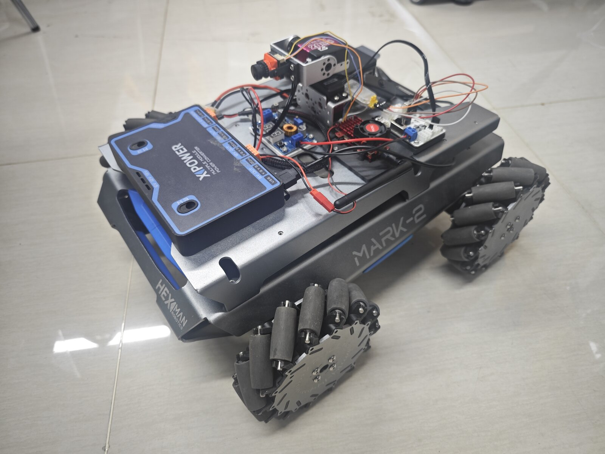
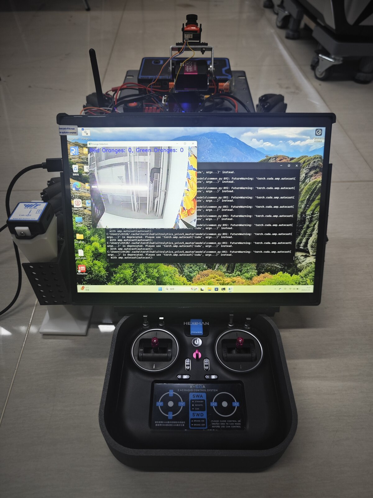
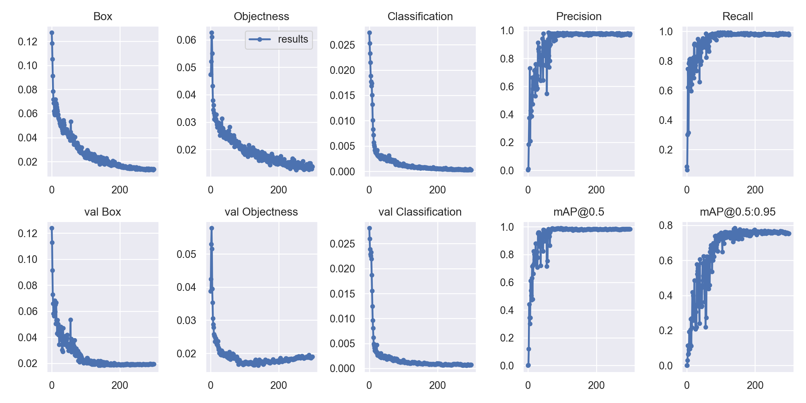
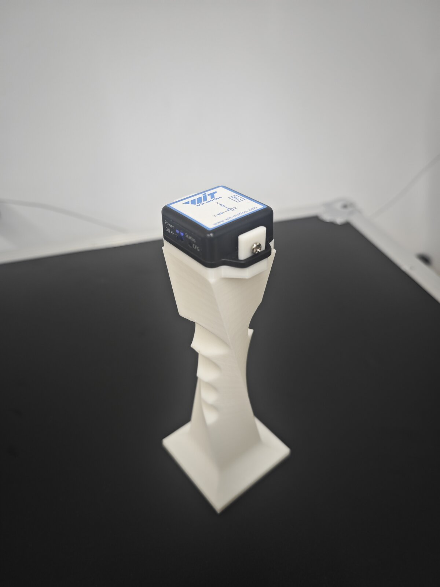

# Orchard Patrol Robot

An unmanned patrol vehicle that helps farmers monitor fruit orchards remotely, built as a Regeneron science fair project.



## Why
Checking an orchard by hand is slow, tiring, and easy to get wrong. On a 100 hectare farm, it can take five workers ten hours to look over every tree for ripeness, pests, and disease. With this vehicle, one operator can run the same patrol from a tablet in about 3 hours.

## Features
- **Omnidirectional movement:** Mecanum wheels let the vehicle move sideways and turn in place between narrow plant rows.
- **IMU controlled gimbal camera:** A Raspberry Pi 4B receives orientation data from a WiFi IMU over UDP and maps it to a yaw servo and a pitch servo through a serial servo driver. The operator tilts their hand and the camera follows.
- **Fruit ripeness detection and counting:** A YOLOv5s model trained on images I labeled by hand finds oranges, sorts them into ripe and unripe, and counts each class frame by frame on the live video stream.
- **Live video:** A 5GHz wireless video module streams footage straight to the operator's tablet.
- **Field data collection:** A tablet app lets the operator capture close up images of pests and disease, building a dataset for future models.



## Model
Built on [YOLOv5 v5.0](https://github.com/ultralytics/yolov5) (YOLOv5s). I hand labeled 286 orchard images in LabelImg into two classes, `orange` (ripe) and `green_orange` (unripe), split 226 for training and 60 for validation, and trained for 300 epochs.

| Metric | Validation |
|---|---|
| Precision | 0.97 |
| Recall | 0.98 |
| mAP@0.5 | 0.98 |
| mAP@0.5:0.95 | 0.75 |



## Hardware
Raspberry Pi 4B, WiFi IMU module, two serial bus servos (240° range, 0.3° accuracy), USB to TTL converter, Mecanum wheel chassis, 5GHz wireless video transmitter and receiver, tablet, and remote controller. I designed the IMU, servo, controller, and buck converter mounts in SolidWorks and 3D printed them.



## Repository structure
```
gimbal_control/    IMU data parsing, angle to servo mapping, and servo commands (runs on the Raspberry Pi)
fruit_detection/   Detection and ripe/unripe counting scripts, dataset and model config
tablet_app/        PyQt5 app for capturing field images from the live camera feed
cad/               STL files for the 3D printed mounts
images/            Photos and training results
```

The detection scripts run inside a YOLOv5 v5.0 checkout. Model weights and the dataset are not included because of their size.

## Testing
- **Gimbal control:** Rotating the IMU clockwise or counterclockwise turned the yaw servo in sync, and tilting it moved the pitch servo from horizontal up to vertical.
- **Live detection:** With oranges of different ripeness placed in front of the camera, the model running on the tablet detected, classified, and counted them correctly.

## Future work
- Higher resolution, interference resistant video transmission
- A pest and disease detection model trained on a larger dataset
- GPS tracking to find the vehicle in large fields
- Drones scanning from above while the vehicle inspects up close
- Adapting the platform to other crops like apples and grapes
